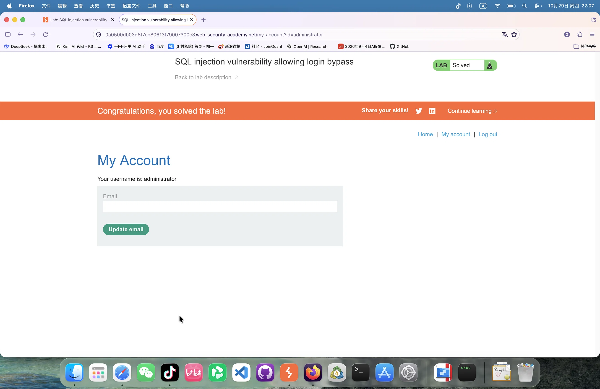

# 第一阶段 Day 1：Web 安全与抓包基础

## 一、环境搭建
- 浏览器：Firefox
- 抓包工具：Burp Suite Community Edition
- 代理插件：FoxyProxy (127.0.0.1:8080)
- 证书配置：成功导入 Burp CA 证书

## 二、漏洞实战：SQL 注入（SQLi）
- **靶场**：PortSwigger Web Security Academy - Lab 1
- **目标**：利用 SQL 注入获取隐藏数据
- **原始请求**：`GET /filter?category=Accessories HTTP/2`
- **Payload**：`' OR 1=1--`
- **漏洞原理解释**：
  后端未对用户输入进行严格过滤，直接拼接到 SQL 语句中。`'` 闭合了原有字符串，`OR 1=1` 使得查询条件恒为真，`--` 注释掉后续代码。
- **风险**：导致敏感数据泄露（不仅能看到普通商品，还能看到隐藏/下架商品，甚至直接拖库）。
- **证据留存**：[在此插入你刚才那张绿色的 Solved 截图]

## 三、关联 AI 安全（审计视角）
- 传统 SQL 注入与 AI 中的“提示词注入”本质相同，都是系统将“不可信的数据”当成了“可执行的指令”。
- 《AI-Red 指南》第 11 章中，黑客正是利用 LLM 缺乏输入验证，通过聊天框让 AI 代理执行了 `xp_cmdshell`，导致了系统的彻底沦陷。
## 四、漏洞实战：SQL 注入实现登录绕过 (Lab 2)
- **目标**：绕过登录验证，以 administrator 身份登录
- **请求方法**：POST /login
- **原始 Payload**：`username=administrator&password=123`
- **攻击 Payload**：`username=administrator'--&password=123`
- **漏洞原理解释**：
  后端执行了 `SELECT * FROM users WHERE username = 'administrator'--' AND password = '123'`。
  `--` 将后面的密码验证逻辑完全注释掉，导致数据库只核对用户名，不核对密码，直接放行。
- **风险**：极其严重的身份验证绕过，攻击者可直接接管高权限账户。
- **证据留存**：[插入你刚才登录成功的截图]